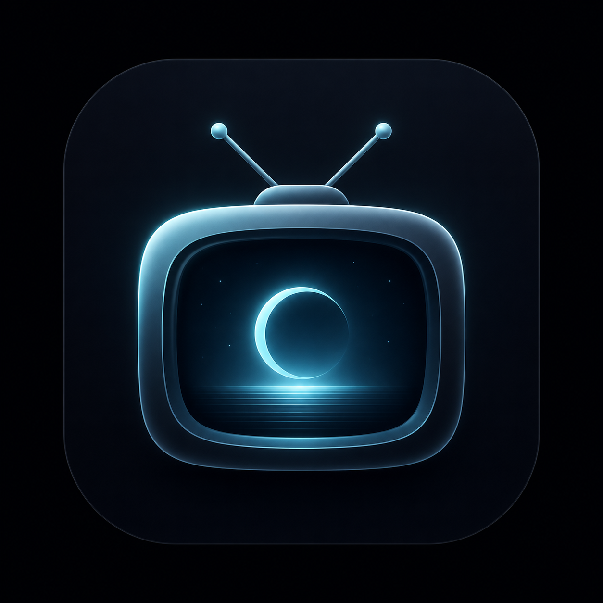

# Moglog

  

  <strong>A clean, private, and modern TV show tracker for Android.</strong>

  
  
  

---

## 📥 Download & Installation

1. Go to the **[Latest Release](https://github.com/tshivaneshk/Moglog-Releases/releases/latest)** page.
2. Under the **Assets** dropdown, download **`Moglog-v3.0.0.apk`**.
3. Open the downloaded file on your Android device to install.
   *(If prompted by Android, grant permission to "Install unknown apps" for your browser or file manager).*

---

## ✨ Features at a Glance

* 📱 **Interactive Glance Home Widget**: Log your episodes right from your home screen with quick `+1 EP` / `-1 EP` buttons and an 8-microsegment continuous progress bar.
* 🗂️ **Custom Collection Shelves**: Organize your series into custom categories (*Comfort Shows*, *Weekend Binge*, etc.) with quick long-press management.
* 🌟 **Top 4 All-Time Favorites**: Spotlight your favorite series on your personal profile pass.
* 📊 **Moglog Wrapped & Binge Calculator**: View your binge statistics, episode air-date radar, and remaining marathon time calculations.
* 👥 **Watch Circle**: Connect with friends using private invite codes to compare taste compatibility and follow live co-watch progress.
* 🔒 **Offline-First & Encrypted**: Encrypted local database storage, customizable show privacy controls, and optional Google cloud sync.

---

## 🔑 Getting Your TMDB API Key (2-Minute Setup)

Moglog is 100% free, private, and ad-free. It connects to The Movie Database (TMDB) to fetch accurate show metadata, posters, and air dates. To use Moglog, simply provide your own free TMDB API key:

1. **Sign Up / Log In**: Visit [themoviedb.org](https://www.themoviedb.org/) and create a free account (or log in).
2. **Navigate to API Settings**: Click on your profile icon in the top right $\rightarrow$ **Settings** $\rightarrow$ select **API** from the left sidebar.
3. **Generate an API Key**: Click **Create** $\rightarrow$ choose **Developer** $\rightarrow$ accept the terms and fill in standard app details *(e.g., Application Name: `Moglog`, Type: `Personal`)*.
4. **Copy Key**: Copy your **API Read Access Token** or **API Key (v3)**.
5. **Paste in Moglog**: Open Moglog, paste your key into the setup prompt, and tap **Save**.

---

## 💬 Feedback & Community

* **Found a bug?** Please submit a detailed report via [GitHub Issues](https://github.com/tshivaneshk/Moglog-Releases/issues).
* **Have an idea or question?** Join the discussion and share suggestions in [GitHub Discussions](https://github.com/tshivaneshk/Moglog-Releases/discussions).

---

## ⚖️ Disclaimer & Attribution

* This product uses the TMDB API but is not endorsed or certified by TMDB.
* All TV series posters, images, and metadata are provided by [The Movie Database (TMDB)](https://www.themoviedb.org/).

---

  Crafted with care by <strong>SKECH</strong> • Copyright © 2026 Shivanesh K. All rights reserved.

